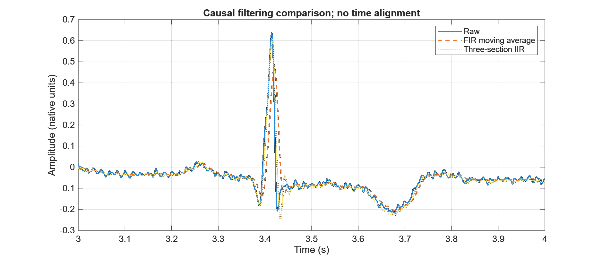
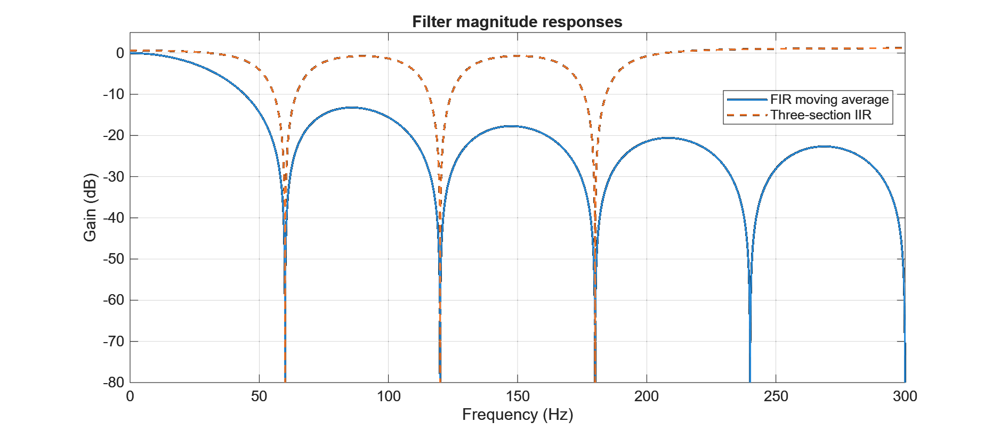
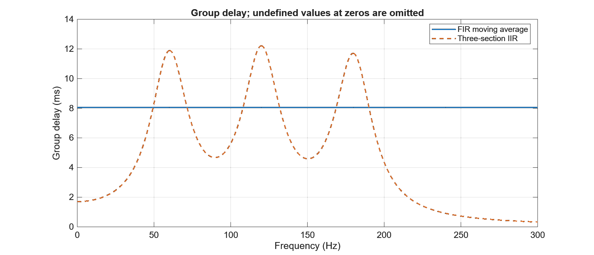

<<<<<<< HEAD
# ECG 訊號分析與 FIR／IIR 濾波器比較

使用 MATLAB 進行 ECG 頻譜分析、數位濾波器設計與量化比較。
本專案關注的問題是：**抑制指定頻率成分時，濾波器如何同時改變訊號的幅度、局部波形與時間延遲？**

[完整技術報告（PDF）](report/ECG_Report.pdf) · [LaTeX 原始碼](report/main.tex)

## 專案內容

以一筆取樣率為 1800 Hz、長度為 15000 個樣本的 ECG 紀錄，完成以下分析：

- 比較完整紀錄與固定時間片段的 FFT 頻譜，並依候選 R 波的 R–R 間隔估計心率。
- 由頻率響應零點推導 30 點 FIR 移動平均濾波器，並設計 60／120／180 Hz 的三段 IIR 陷波器。
- 在共同條件下比較頻帶功率、幅度響應、群延遲與局部波形。

## 方法

FIR 的長度由 `M = Fs / 60 = 30` 決定，使 60 Hz 及相應諧波落在頻率響應零點上。
IIR 以單位圓零點對應三個目標頻率，極點半徑固定為 `r = 0.95`，並串接三個二階系統。
IIR 未另行正規化 DC 增益，計算值為 1.076204。

兩種方法都採用零初始狀態的因果 `filter()`，不使用 `filtfilt()`，也不先平移輸出。
功率比較取 1.000000–8.332778 秒，共 13200 個樣本；分別去平均值、乘上 periodic Hann window，
再對相同頻率格點的單邊功率頻譜密度積分近似。

## 實驗結果

下表為 2026-10-03 執行紀錄中的結果，評估頻帶為各中心頻率 ±1 Hz。

| 評估頻帶 | FIR 頻帶功率降低量 | 三段 IIR 頻帶功率降低量 |
| --- | ---: | ---: |
| 60 ± 1 Hz | 46.2567 dB | 33.1245 dB |
| 120 ± 1 Hz | 52.5738 dB | 33.6474 dB |
| 180 ± 1 Hz | 55.8174 dB | 33.2339 dB |

FIR 在指定頻帶的降低量較大，但也具有較廣的頻率衰減與 **8.055556 ms** 的固定群延遲。
三段 IIR 的群延遲隨頻率改變，且增益不完全為 1。因此，結果不是其中一種濾波器在所有目標上都較好。

另外，候選峰值分析得到 **11 個峰值、10 個使用的 R–R 間隔**，平均間隔 **0.811389 秒**，估計心率 **73.9473 bpm**。
此數值描述本次資料與參數下的時域估計，不是偵測準確率。

## 成果展示

### 相同時間軸上的局部波形

### 濾波器幅度響應

### 群延遲

## 重現條件與限制

實驗環境記錄為 MATLAB `26.1.0.3346908 (R2026a) Update 5`。
數值分析使用 MATLAB 與 Signal Processing Toolbox；重現需具備同一次實驗使用的 `run_demo.m`、
ECG 資料、取樣率、係數、峰值參數與分析區間，並保留 CSV 與執行紀錄以便核對。
報告的編譯方式見 [編譯說明](docs/BUILD_REPORT.md)。

本專案的結論限於單筆資料與既定參數，沒有乾淨參考訊號或人工 R 波標註。
頻帶功率降低量不是純雜訊衰減或訊噪比改善量；相對原訊號差異較小也不等同去雜訊品質較好。
候選峰值採 0.6 秒最小間距，不可直接推廣至所有心率。此實作不作為醫療診斷系統。

## 來源與工具

數值與圖形對應《ECG 訊號分析與 FIR／IIR 濾波器比較》2026-10-03 MATLAB 執行紀錄；
方法與函式參考列於報告末尾。程式整理與文件撰寫使用 AI 輔助。
原始資料與衍生圖表的公開權利需另行確認，本文不替來源材料授予新的使用授權。
=======
# ecg-filter-comparison
some results for analysis of ECG 
>>>>>>> origin/main
